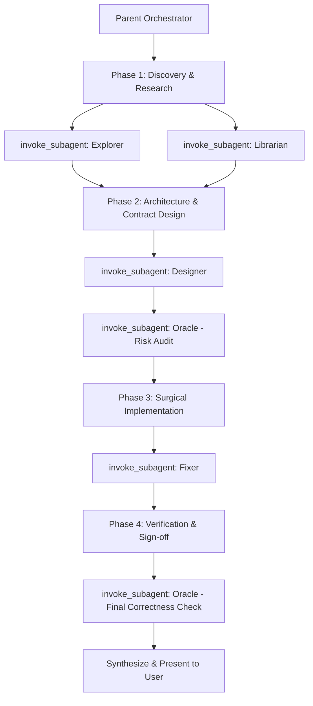

# Multi-Agent Delegation Protocol (Oh-My-OpenCode-Slim Architecture)

This workspace is configured with a modular, specialist subagent architecture located in `.agents/agents/`. The parent orchestrator **MUST** automatically delegate sub-tasks to these specialized roles using `invoke_subagent` during complex tasks, multi-file refactors, and `/goal` execution loops.

---

## 1. Specialist Subagent Roster

| Role | Agent File | Primary Focus | Mode / Boundaries |
| :--- | :--- | :--- | :--- |
| **Explorer** | [`.agents/agents/explorer.md`](file:///Users/dibble/Documents/GitHub/lumen-os/.agents/agents/explorer.md) | Symbol lookup, ripgrep, codebase structure, AST mapping | `mode: plan` (Read-only) |
| **Librarian** | [`.agents/agents/librarian.md`](file:///Users/dibble/Documents/GitHub/lumen-os/.agents/agents/librarian.md) | Dependency audits, official documentation, external API research | Research / Read-only |
| **Designer** | [`.agents/agents/designer.md`](file:///Users/dibble/Documents/GitHub/lumen-os/.agents/agents/designer.md) | System design, schema modeling, API contract authoring | `mode: plan` (Design-only) |
| **Oracle** | [`.agents/agents/oracle.md`](file:///Users/dibble/Documents/GitHub/lumen-os/.agents/agents/oracle.md) | Architectural review, edge-case discovery, complexity audits | Review / Adversarial Audit |
| **Fixer** | [`.agents/agents/fixer.md`](file:///Users/dibble/Documents/GitHub/lumen-os/.agents/agents/fixer.md) | Surgical code modification, localized testing, bug remediation | `mode: accept-edits` (Scoped write) |

---

## 2. Autonomous Delegation Lifecycle

When executing multi-step goals or complex architectural changes, follow this 4-phase delegation pipeline:

### Phase 1: Discovery & Intelligence Gathering
- **Explorer**: Delegate codebase exploration, locating symbol definitions, call traces, and dependent files.
- **Librarian**: Delegate dependency audits, lockfile checks, and third-party library API verifications.

### Phase 2: Design & Adversarial Review
- **Designer**: Delegate technical specification drafting, TypeScript/Proto interface designs, and state schemas.
- **Oracle**: Delegate pre-implementation review to stress-test the design against edge cases, race conditions, and complexity bottlenecks.

### Phase 3: Surgical Execution & Testing
- **Fixer**: Delegate implementation of the approved design to make surgical edits to target files and run localized unit tests.

### Phase 4: Verification & Audit
- **Oracle**: Delegate final diff inspection and test verification to ensure no invariant regressions or unhandled failure modes.

---

## 3. Subagent Invocation Standards

1. **Focused Scoping**: Give each subagent an unambiguous, single-responsibility prompt. Specify target directories, files, or symbols.
2. **Context Isolation**: Rely on subagents to absorb voluminous file reads, search outputs, and test logs. The parent context receives only the structured report returned by each specialist.
3. **Structured Handoffs**: Parse the subagent's structured Markdown report (Key Locations, Fixer Diff, Oracle Risk Matrix, Designer Contract) and incorporate key findings directly into the project plan or artifact.
